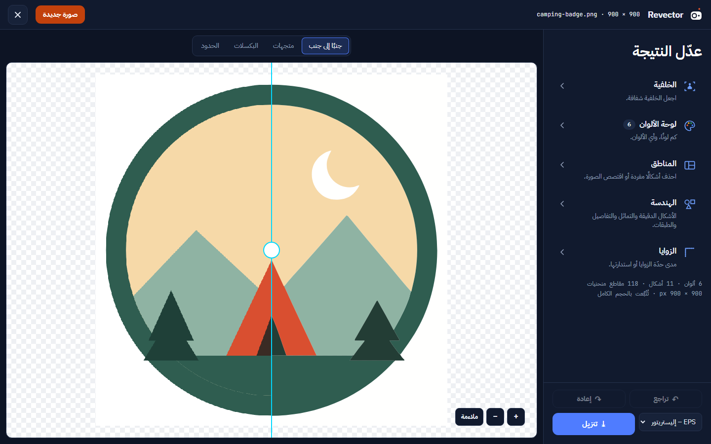

<picture>
  <source media="(prefers-color-scheme: dark)" srcset="docs/img/logo-dark.svg">
  
</picture>

<h1>Revector</h1>

<strong>حوّل البكسلات إلى رسوم متجهة نظيفة قابلة للتعديل.</strong> 
مجاني · يعمل دون إنترنت · بلا حساب · بلا علامة مائية

  
  
  

<h3>
  <a href="https://github.com/Midoelprince/revector/releases/latest">تنزيل لويندوز</a>
   · 
  <a href="README.md">English</a>
</h3>

برنامج **Revector** يعيد رسم صور PNG وJPG وWebP وGIF وBMP كملفات SVG وEPS وPDF وDXF بمنحنيات ناعمة وأشكال حقيقية. كل شيء يعمل على حاسوبك: لا رفع للصور، ولا تسجيل، ولا دفع عند زر التنزيل.

## المزايا

- **تتبّع تلقائي:** افتح الصورة ويبدأ التتبّع فورًا، مع إمكانية تعديل الألوان والتفاصيل والزوايا.
- **أشكال حقيقية:** الدوائر والأشكال البيضوية والمستطيلات والمضلعات والنجوم تخرج كأشكال هندسية دقيقة.
- **الصور الصغيرة والمشوشة:** الصور الأصغر من 800 بكسل يُعاد بناؤها بأربعة أضعاف قبل التتبّع.
- **تعديل الألوان:** أعد تلوين أي لون أو ادمجه أو أخفه، واحذف الخلفية بنقرة.
- **تعديل الأشكال:** احذف أشكالًا بالنقر، واقصص، وأضف تماثلًا، وتحكّم في حدّة الزوايا، مع تراجع وإعادة.
- **خمس صيغ:** SVG وEPS وPDF وDXF وPNG بدقة عالية.
- **خصوصية تامة:** لا يحتاج إلى إنترنت، وصورك لا تغادر حاسوبك.
- **واجهة عربية كاملة** من اليمين إلى اليسار، وتحديث تلقائي للنسخة المثبّتة.

## التنزيل

| الملف | مناسب لـ |
| --- | --- |
| **[Revector-Setup.exe](https://github.com/Midoelprince/revector/releases/latest)** | معظم المستخدمين. يضيف اختصارًا ويحدّث نفسه. |
| **[Revector-Portable.exe](https://github.com/Midoelprince/revector/releases/latest)** | الفلاش والأجهزة التي لا تسمح بالتثبيت. التحديث يدوي. |

يعمل على ويندوز 10 و11 (64 بت).

> **ملاحظة:** البرنامج غير موقّع رقميًا بعد، لذلك قد يظهر تحذير SmartScreen. اضغط **More info ← Run anyway**. كل إصدار يُبنى علنًا من هذا المستودع.

## طريقة الاستخدام

1. **افتح** صورة: اضغط «افتح صورة» أو اسحبها أو الصقها بـ Ctrl+V.
2. **قارن** النتيجة بعرض «جنبًا إلى جنب».
3. **عدّل** إن احتجت: الألوان والخلفية والمناطق والهندسة والزوايا.
4. **نزّل** الملف بالصيغة التي تريدها.

## أي صيغة أختار؟

| الصيغة | الاستخدام |
| --- | --- |
| **SVG** | المواقع وFigma وInkscape وCanva |
| **EPS** | Adobe Illustrator والمطابع |
| **PDF** | الطباعة والمشاركة |
| **DXF** | برامج CAD والليزر وCNC |
| **PNG** | نسخة نقطية حادة بأي حجم |

## الرخصة

[MIT](LICENSE). البرنامج مجاني ومفتوح المصدر.

إذا وفّر عليك Revector وقتًا، فنجمة ⭐ تساعد غيرك على إيجاده.

