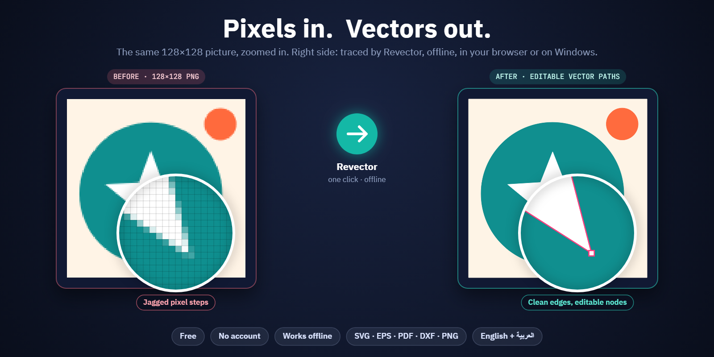
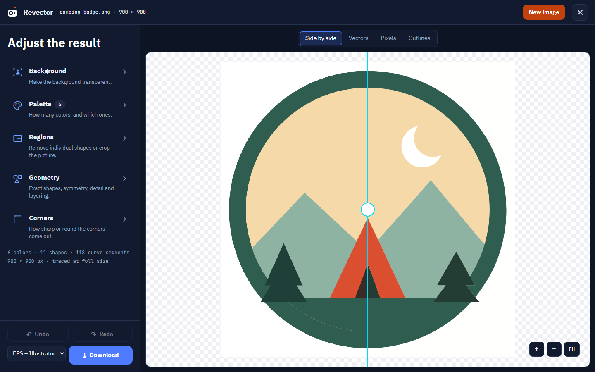
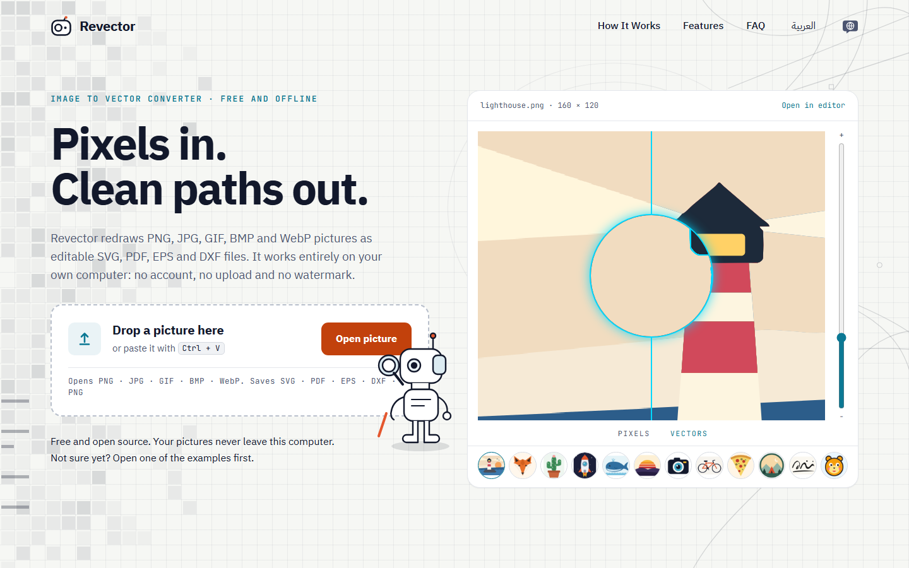
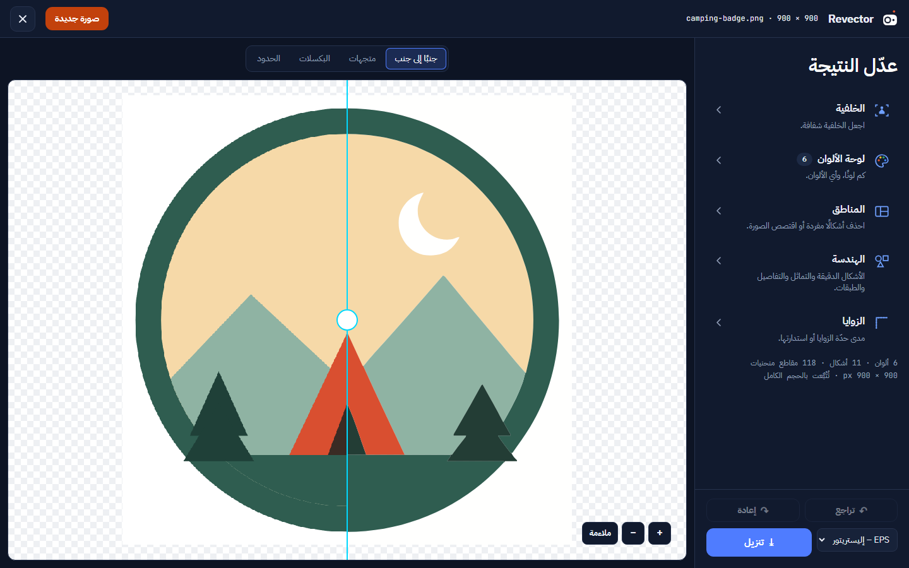

<div align="center">

<picture>
  <source media="(prefers-color-scheme: dark)" srcset="docs/img/logo-dark.svg">
  
</picture>

<h1>Revector</h1>

<p><strong>Turn pixels into clean, editable vectors.</strong><br>
Free · Offline · No account · No watermark</p>

<p>
  <a href="https://github.com/Midoelprince/revector/releases/latest"></a>
  <a href="https://github.com/Midoelprince/revector/releases"></a>
  
  <a href="LICENSE"></a>
</p>

<h3>
  <a href="https://github.com/Midoelprince/revector/releases/latest">Download for Windows</a>
  <span> · </span>
  <a href="#features">Features</a>
  <span> · </span>
  <a href="#faq">FAQ</a>
  <span> · </span>
  <a href="README.ar.md">العربية</a>
</h3>



</div>

<br>

**Revector** redraws PNG, JPG, WebP, GIF and BMP pictures as SVG, EPS, PDF and DXF files with smooth curves and true shapes. Everything runs on your own computer: there is no upload, no sign-up and no paywall at the download button.

## Contents

- [Features](#features)
- [Screenshots](#screenshots)
- [Download](#download)
- [How to use](#how-to-use)
- [Which format should I pick?](#which-format-should-i-pick)
- [FAQ](#faq)
- [Build from source](#build-from-source)
- [Contributing](#contributing)
- [License](#license)

## Features

<table>
<tr><td width="230">🎯 <b>Automatic tracing</b></td><td>Open a picture and the trace starts at once. Colours, detail and corners are chosen for you, and you can change them all.</td></tr>
<tr><td width="230">⭕ <b>True shapes</b></td><td>Circles, ellipses, rectangles, rounded rectangles, polygons and stars come out as real geometry, not wobbly outlines.</td></tr>
<tr><td width="230">🔍 <b>Small and blurry pictures</b></td><td>Pictures under 800 px are rebuilt at 4× before tracing, so pixel steps and soft halos turn into clean curves.</td></tr>
<tr><td width="230">🎨 <b>Palette editing</b></td><td>Recolour, merge, split or hide any colour, and remove the background with one click.</td></tr>
<tr><td width="230">✂️ <b>Shape editing</b></td><td>Click shapes away, crop, add mirror symmetry, and set how sharp or round corners come out. Undo and redo with Ctrl+Z / Ctrl+Y.</td></tr>
<tr><td width="230">👀 <b>Side-by-side check</b></td><td>Drag the divider between pixels and vectors, or switch to vectors only, pixels only or outlines.</td></tr>
<tr><td width="230">📦 <b>Five formats</b></td><td>SVG, EPS, PDF, DXF and high-resolution PNG. Stacked or cut-out layering, and an optional gap filler.</td></tr>
<tr><td width="230">🔒 <b>Private</b></td><td>No network needed. Your pictures never leave your computer.</td></tr>
<tr><td width="230">🌐 <b>English and Arabic</b></td><td>The whole interface, including the editor, switches to a right-to-left Arabic layout.</td></tr>
<tr><td width="230">🔄 <b>Updates itself</b></td><td>The installed app tells you when a new version is out and installs it for you.</td></tr>
</table>

## Screenshots

<p align="center">
  
</p>

<details>
<summary><b>More screenshots</b></summary>
<br>

| Home page | Arabic editor |
| --- | --- |
|  |  |

</details>

## Download

| File | Best for |
| --- | --- |
| **[Revector-Setup.exe](https://github.com/Midoelprince/revector/releases/latest)** | Most people. Adds a Start menu and desktop shortcut, and updates itself. |
| **[Revector-Portable.exe](https://github.com/Midoelprince/revector/releases/latest)** | USB sticks and computers where you can't install. Download the new version by hand to update. |

Windows 10 or 11, 64-bit. You can also run Revector in your browser from the source; see [Build from source](#build-from-source).

> [!NOTE]
> Revector is not code-signed yet, so Windows SmartScreen may say *"Windows protected your PC"*. Click **More info → Run anyway**. Every release is built from this repository by the public [Release workflow](.github/workflows/release.yml).

## How to use

1. **Open** a picture: click *Open picture*, drag it in, or paste it with Ctrl+V. Tracing starts by itself.
2. **Check** the result with the side-by-side view. The panel shows how many colours, shapes and curve segments it has.
3. **Adjust** if you need to: palette, background, regions, geometry and corners.
4. **Download** as SVG, EPS, PDF, DXF or PNG.

> [!TIP]
> Logos, icons, stickers and flat artwork give the cleanest results. For a photo, set the number of colours by hand and crop to the part you need.

## Which format should I pick?

| Format | Use it for |
| --- | --- |
| **SVG** | Websites, Figma, Inkscape, Canva |
| **EPS** | Adobe Illustrator and print shops |
| **PDF** | Printing and sharing; opens anywhere |
| **DXF** | CAD, laser cutters and CNC (outlines) |
| **PNG** | A sharp raster copy at any size |

## FAQ

<details>
<summary><b>Is it really free?</b></summary>
<br>
Yes. Every format downloads for free, with no account, no limits and no watermark. Revector is open source under the MIT license.
</details>

<details>
<summary><b>Are my pictures uploaded anywhere?</b></summary>
<br>
No. Tracing runs on your own computer, and the app works with the network turned off.
</details>

<details>
<summary><b>What is the gap filler?</b></summary>
<br>
Shapes that touch can show thin hairline seams in some viewers. The gap filler adds a same-colour outline one pixel wide to hide them. It is off by default. Leave it off for cutting machines, because it makes shapes very slightly bigger.
</details>

<details>
<summary><b>How big can a picture be?</b></summary>
<br>
Any size opens. Pictures larger than 4096 px on a side are reduced to 4096 px before tracing.
</details>

## Build from source

You need [Node.js](https://nodejs.org/). The release build uses version 22.

```bash
git clone https://github.com/Midoelprince/revector.git
cd revector
npm install
npm run build          # builds the site into dist/
node scripts/serve.mjs # opens it at http://127.0.0.1:4173
```

To package the Windows app, run `npm run dist`. The project layout, release steps and engine tests are in [docs/DEVELOPMENT.md](docs/DEVELOPMENT.md).

## Contributing

Bug reports and ideas are welcome in [Issues](https://github.com/Midoelprince/revector/issues). Please attach the picture that traced badly if you can. For code changes, read [docs/DEVELOPMENT.md](docs/DEVELOPMENT.md) first.

## License

[MIT](LICENSE). The interface uses IBM Plex Sans Arabic and JetBrains Mono under the SIL Open Font License.

<div align="center">
<br>
<sub>If Revector saved you time, a ⭐ helps other people find it.</sub>
</div>
